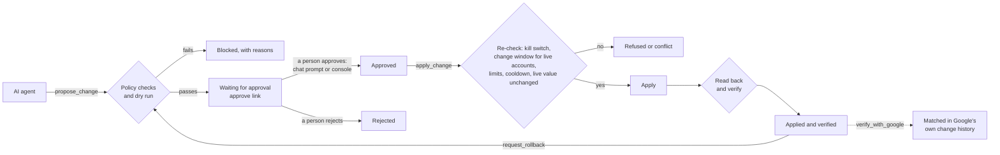

# Campaign Ops MCP

**Lets AI agents change Google Ads campaigns safely.** Every change is proposed, checked, dry-run, approved by a person, applied, verified and reversible, with Fair Housing guardrails, a tamper-evident audit log, and an independent check against Google's own change history.

**[See the live run on Google Ads](https://debashishkumarbora.github.io/agents/campaign-ops/)**: the record of its first run on a real Google Ads test account. It found an ad that broke Fair Housing rules, waited for a person to approve the fix, then changed the ad through the Google Ads API and verified it.

**[Try the live demo](https://debashishkumarbora.github.io/campaign-ops/)**: the real engine, compiled to run in your browser on a fictional sandbox account. Approve the agent's fixes, then try to make it misbehave.

It runs on three kinds of account, side by side:

| Account | Numbers | Changes |
|---|---|---|
| Built-in sandbox | Synthetic, with problems planted on purpose | With your approval |
| Google Ads test account | Simulated (test accounts never show ads) | With your approval, through the Google Ads API |
| Live Google Ads account | Real spend, clicks, leads and search terms | Off until a person opens a change window, then each one with your approval |


## What's new in 0.3

- **Live accounts, read-only by default.** `npm run gads:add` connects a real Google Ads account. Campaign Ops reads its real numbers, but nothing can change until a person opens a time-boxed change window in the console by typing the account's name. No tool can open one.
- **Google as witness.** `verify_with_google` compares Google's own change history with the approval log. Every change made with the Campaign Ops key must match an approved proposal. Anything else raises an alarm, and edits by people, other tools and Google's auto-applied recommendations are listed.
- **Pulse.** Day-by-day alarms a monthly report misses: conversion tracking that stopped while clicks kept coming, campaigns that stopped spending, overnight spend spikes and lead drops. Each alarm says how unlikely the pattern is by chance.
- **Approve links.** Every proposal comes with a link that opens the console on that exact proposal.
- **Pause one ad.** `set_ad_status` pauses or enables a single ad. A Fair Housing problem gets a one-step stopgap: pause the ad now, fix the copy next. A flagged ad cannot be turned back on until its copy is fixed.
- **A redesigned console** that works on a phone, ready for approving away from the desk.

## Why this exists

Google's official Google Ads MCP server is read-only. Its tools search an account, describe resources and list accounts. Reading is the easy part.

Once an agent can change budgets, negative keywords or ad copy, it needs the same controls a careful media buyer uses: limits, a second pair of eyes, a record of every decision, and an undo. Campaign Ops is that control layer, built as an MCP server that any MCP client can use.

## How a change flows



## Guardrails

| Guardrail | What it does |
|---|---|
| No self-approval | There is no approve tool. Only a person can approve, through an approval prompt in the chat app (MCP elicitation) or the local approval console. |
| Live accounts stay read-only | A live account can be read and proposals can be approved, but nothing is applied until a person opens a change window in the console. Windows last 1 to 8 hours, end on their own, and can be locked early. The backend itself refuses live writes without one. |
| Scopes | `read`, `propose` or `execute`. Tools outside the scope are not even listed to the AI. |
| Budget limits | Step limits per change (+30% / -50% by default), a per-campaign range, and an account-wide daily cap. |
| Fair Housing screening | Ad copy that states a preference or limitation (for example "adults only" or "perfect for couples") is blocked. Coded or age-signaling language is flagged for review. Re-enabling a flagged ad is blocked too. |
| Protected searches stay visible | Negative keywords that would exclude protected groups are always blocked. A naive optimizer would cut "wheelchair accessible apartments" for having zero conversions. Campaign Ops refuses, and says why. |
| Collateral-damage check | Negatives that would also block converting searches are flagged, or blocked above a threshold. |
| Brand protection | Negatives that would block searches for your own community name are blocked. |
| Dry run | Every proposal is validated by the platform without being applied (the Google Ads API calls this `validate_only`). |
| Drift detection | If someone changed the live value after the proposal, nothing is overwritten. The result is a conflict, and the agent re-proposes from fresh data. |
| Approval binding | An approval is tied to a hash of the exact change. Editing the stored proposal afterwards is detected and refused. |
| Expiry | Proposals expire after 24 hours and approvals after 60 minutes. |
| Rate limits and cooldowns | Caps changes per hour and per day, and spaces out repeat changes to the same target. One open proposal per target. |
| Kill switch | One click in the console pauses every change, inside a change window too. An environment variable can force it on, overriding everything. |
| Verification | After writing, the account is read back and compared with the expected state. |
| Rollback is a proposal | An undo goes through the same checks and approval. Undoing a Fair Housing fix is blocked, because it would restore the violation. |
| Tamper-evident audit log | Every event is written to a hash-chained log. Editing or deleting any line breaks the chain, and the tool reports exactly where. |
| Google as witness | Google Ads keeps its own record of every change for 30 days. Campaign Ops checks itself against it: a change made with its key that matches no approval is an alarm. |

## Oversight

**Pulse** reads each campaign's daily numbers and raises an alarm only when a pattern is very unlikely to be chance. It uses a Poisson model of leads per click, so every alarm says how unlikely it is in plain words, for example "about 1 in 95". Four alarms:

| Alarm | What it catches |
|---|---|
| Tracking outage | No leads for several days while clicks kept coming. Usually a broken form or tag, not the ads. Automated bidding reacts to the false drop, so it is listed first. |
| Stopped spending | An enabled campaign that suddenly spends nothing: disapprovals, billing or an end date. |
| Spend spike | Yesterday far above the usual daily spend. |
| Lead drop | Leads per click fell by more than half this week while clicks held. |

**The witness check** compares Google's change history with the approval log. It reports every robot change that matched an approved proposal, any change made with the robot's credentials that matches nothing (someone used the key outside Campaign Ops), applied proposals Google has no record of, and the edits people, other tools and Google's own auto-applied recommendations made. The sandbox keeps the same kind of history, so the check works in the demo too.

Neither one changes anything. They say what to check, and any fix still goes through a proposal and approval.

## Quick start

Requires [Node.js](https://nodejs.org) 22 or newer (any current LTS) and Git.

```bash
git clone https://github.com/debashishkumarbora/campaign-ops-mcp.git
cd campaign-ops-mcp
npm install
npm test        # 75 tests: guardrails, live accounts, Pulse, witness, console security, MCP over stdio, Google Ads API
npm run demo    # a narrated run through every guardrail
```

Everything runs against a sandbox account with synthetic data. No Google account is needed yet.

## Call the tools yourself

```bash
npm run build
npm run inspect
```

This opens [MCP Inspector](https://github.com/modelcontextprotocol/inspector) in your browser. Click **Connect**, open **Tools**, and run `run_diagnostics` with `account_id` set to `123-456-7890`.

## The approval console

```bash
npm run console
```

This opens the console in your browser with your key, and the browser remembers it. Proposals appear within a few seconds of the agent making them, and the approve link from the chat opens the exact one.

- **Account tabs** show each account's kind, whether its numbers are real, Pulse alarms, and whether it matches Google's record. Live accounts show their lock, with **Open change window** and **Lock now**.
- **Waiting for you** shows each proposal as a redline: the old value struck through, the new value in signature ink, every check, and what approving lets the AI do.
- **Watching** shows Pulse alarms with a chart of the days behind them, and the ledger: Campaign Ops approvals above, Google's record below, each matched pair joined.
- **Decisions, guardrail stops and the audit log** keep the full history, with one-click undo.
- On a phone it becomes an app with three tabs: Approve, Watch and Record.

The console listens on `127.0.0.1` only, requires a key the AI never sees, checks the Host header (DNS rebinding), refuses cross-site requests, escapes everything the AI writes, and runs under a strict Content Security Policy. Pulse and witness results are reused for five minutes, so the console never burns through the API's daily limits.

## The browser demo

The live demo runs the same engine, sandbox, diagnostics and Fair Housing code as the MCP server. `scripts/build-web.mjs` bundles them with esbuild and swaps only Node's file system, path and hashing modules for small in-memory versions (`web/shims`), so every guardrail behaves exactly as it does in Node. SHA-256 output matches Node byte for byte.

```bash
npm run build:web   # writes web/site/engine.js
```

`web/site` is a static site (HTML, CSS, JS). Host it anywhere, for example GitHub Pages. Add `?embed=app` to the address for a compact app view with only the workspace and a Replay tab, which is how the portfolio's phone app shows it.

## Connect an AI client

Campaign Ops runs as a local (stdio) MCP server. Point your MCP client at the built entry file:

```json
{
  "mcpServers": {
    "campaign-ops": {
      "command": "node",
      "args": ["/full/path/to/campaign-ops-mcp/dist/src/index.js"]
    }
  }
}
```

On Windows, use a path like `E:\\campaign-ops-mcp\\dist\\src\\index.js`. Then ask: *"Run a health check on my ad account and propose fixes."* The server also ships two prompts, `account_health_check` and `fix_wasted_spend`.

## Connect a Google Ads test account

Campaign Ops can work on a real Google Ads **test account**: real campaigns, real API calls and Google's own dry run, in an account that can never show ads or spend money.

1. In [Google Cloud](https://console.cloud.google.com), create a project and enable the **Google Ads API**. New projects start with **Test** access, which only works with test accounts.
2. In the same project, create a service account and download its JSON key. Save it as `~/campaign-ops-secrets/google-ads-key.json`, outside this folder so it can never be committed.
3. Create a [Google Ads test manager account](https://developers.google.com/google-ads/api/docs/first-call/test-accounts). Under **Admin > Access and security > Users**, add the service account email with **Admin** access (setup creates the test ad account inside it).
4. Run:

```bash
npm run gads:check -- 724-800-0350   # your test manager account number
npm run gads:setup                   # creates "Demo Apartments" and builds the sample campaigns
```

5. Restart your MCP client. `list_accounts` now shows the sandbox and the test account side by side, and the approval console labels which account each change is for.

No developer token is needed: since September 2026, Google Ads API access belongs to the Cloud project.

Before any change, Campaign Ops asks Google whether the account is a test account and refuses if it is not. `npm run gads:setup -- --fresh` rebuilds the sample campaigns. The setup run is noted in the audit log, so the witness check counts its changes as expected.

## Connect a live Google Ads account

A live account needs two things from Google first:

1. **Explorer access (or higher)** for the Cloud project that owns the robot. Test access cannot touch real accounts. Google reviews each request for a higher access level.
2. **The robot added as a user** of the account, or of a manager account above it: **Admin > Access and security > Users**, add the service account email. Start with **Read only**. Campaign Ops can still read everything, and Google itself blocks every change. Switch it to **Standard** only when you want approved changes to go through.

Then:

```bash
npm run gads:add -- 123-456-7890              # connect it (read-only in Campaign Ops)
npm run gads:add -- --list                    # show what is connected
npm run gads:add -- --remove 123-456-7890     # disconnect it
```

`gads:add` finds how the robot can reach the account (directly or through a manager), confirms with Google that it is a live ad account, reads its campaigns and last 30 days of spend so you can see the numbers are real, and saves it. It changes nothing in Google Ads. If Explorer access is still under review, it says so and stops.

| | Live Google Ads account |
|---|---|
| Spend, clicks, leads, search terms | Real, from Google |
| Pulse and the witness check | On real numbers and Google's real change history |
| Changes | Off until a person opens a change window in the console, typing the account name. Every change still needs its own approval |
| Dry run | Google's own `validateOnly`, always allowed because it changes nothing |

## Tools

| Tool | What it does | Scope |
|---|---|---|
| `list_accounts` | Accounts this server can reach, their mode, and whether changes are allowed right now | read |
| `get_account_overview` | Spend, leads, cost per lead, budget use, impression share lost to budget | read |
| `get_search_terms` | What people searched before clicking, with cost and conversions | read |
| `get_ads` | Ad copy with a Fair Housing screening result per ad | read |
| `run_diagnostics` | Ranked findings with ready-to-propose changes, Pulse alarms, stopgap pauses for Fair Housing problems, and searches that must not be excluded | read |
| `check_pulse` | Day-by-day alarms with how unlikely each pattern is, and what to check | read |
| `verify_with_google` | Google's own change history compared with the approval log | read |
| `check_ad_copy` | Screens draft copy before proposing: Fair Housing, character limits, punctuation | read |
| `get_policy` | The guardrails in force, change windows and the kill switch state | read |
| `list_proposals` / `get_proposal` | Proposal status, every check, the approve link, and the next step | read |
| `get_audit_log` | Recent audit entries and chain integrity | read |
| `propose_change` | The only way to request a change: budgets, campaign status, negative keywords, ad copy, or one ad's status. Runs every check and the dry run, and returns an approve link | propose |
| `request_rollback` | Creates an undo proposal for an applied change | propose |
| `apply_change` | Applies an approved change, re-checking everything first, then verifies | execute |

There is no tool to approve a change or open a change window. Both are human-only.

## Configuration

Copy `.env.example` to `.env` to change settings, and edit `policy.json` to change limits, including `live.maxWindowHours` (8 by default). Fair Housing checks are always on and cannot be switched off in configuration.

| Variable | Default | Meaning |
|---|---|---|
| `CAMPAIGN_OPS_SCOPE` | `execute` | `read`, `propose` or `execute` |
| `CAMPAIGN_OPS_CONSOLE_PORT` | `4848` | Console port on 127.0.0.1. `0` turns it off |
| `CAMPAIGN_OPS_CONSOLE_TOKEN` | generated | Fixed console key (16+ characters) |
| `CAMPAIGN_OPS_KILL_SWITCH` | `0` | `1` refuses every change |
| `CAMPAIGN_OPS_DATA_DIR` | `./data` | Where state lives |
| `CAMPAIGN_OPS_POLICY_FILE` | `./policy.json` | Alternative policy file |
| `CAMPAIGN_OPS_GOOGLE_ADS` | on when set up | `off` hides the Google Ads accounts |
| `CAMPAIGN_OPS_SECRETS_DIR` | `~/campaign-ops-secrets` | Where the robot key and Google Ads connection settings live |
| `GOOGLE_ADS_API_VERSION` | `v26` | Google Ads API version |

`npm run reset` rebuilds the sandbox. When a Google Ads account is connected it keeps proposals and the audit log, because they are the record of real changes the witness check matches with Google. `npm run reset -- --all` clears them too.

## Threat model

**Defends against**

- An agent approving its own changes: no approve tool exists, and both approval channels are human-only.
- An agent unlocking a live account: change windows exist only in the console, need the console key, and need the account name typed by a person.
- Someone using the robot key outside Campaign Ops: the witness check finds every change made with it in Google's own history that matches no approval.
- Prompt-injected text in a proposal attacking the reviewer: all AI-written text is escaped, a strict CSP blocks scripts, and `frame-ancestors 'none'` blocks clickjacking.
- Other web pages in your browser calling the console: key required, Host header checked, JSON-only same-origin POSTs. Approve links carry only a proposal number, never the key.
- Stale or silently edited approvals: binding hash, expiry and drift checks.
- Runaway loops: rate limits, cooldowns, one open proposal per target, and the kill switch.
- Quiet history edits: the hash-chained audit log.

**Out of scope**

- A compromised computer, or an MCP client that fakes the approval prompt.
- An agent that also has file access to the data folder. Do not give the same agent a filesystem tool for this folder.
- Legal review. The Fair Housing checks are a screening aid, not legal advice.

## A note on Fair Housing

Section 804(c) of the Fair Housing Act prohibits housing ads that state a preference, limitation or discrimination based on race, color, religion, sex, disability, familial status or national origin. Many states and cities protect more, such as source of income. The screening rules flag common risk patterns so a person looks before anything ships. They cannot prove that copy is compliant.

## Roadmap

- [x] **Milestone 1:** governance engine, sandbox account, approval console, 28 tests
- [x] **Connected to Claude Desktop:** a real session found the problems, waited for approval, applied and verified three fixes
- [x] **Public browser demo** of the real engine, with a replay of the Claude session
- [ ] **Milestone 2:** approval card inside the chat with [MCP Apps](https://blog.modelcontextprotocol.io/posts/2026-01-26-mcp-apps/)
- [x] **Milestone 3:** Google Ads test-account backend (real API calls, no ads served, no spend). Live run done: Claude found a Fair Housing problem in a real Google Ads test account, a person approved the fix, and the agent rewrote the ad through the Google Ads API
- [x] **Real-account mode (0.3):** live accounts read-only until a person opens a change window, Pulse alarms, the witness check against Google's change history, approve links, single-ad pause, and a phone-ready console
- [ ] **Milestone 4:** the approval console and a remote MCP server on Cloudflare Workers, to approve from a phone anywhere
- [ ] **Milestone 5:** daily autopilot that runs diagnostics and Pulse, and queues proposals for approval
- [ ] **Milestone 6:** evaluation suite that scores agent runs for safe behavior

## Project structure

```
src/
  index.ts              MCP server entry (stdio)
  server.ts             Tools, prompts, approval prompt, approve links, wait-for-approval
  governance/
    engine.ts           Proposal lifecycle: propose, approve, apply, verify, rollback, change windows
    changes.ts          Per-change logic: state, checks, risk, diff, inverse
    fairHousing.ts      Ad copy screening and protected-term detection
    diagnostics.ts      Findings, suggested changes and stopgaps
    pulse.ts            Day-by-day alarms with Poisson odds
    witness.ts          The approval log checked against the platform's own change history
    audit.ts            Hash-chained audit log
  backends/
    backend.ts          The ad platform interface
    sandbox.ts, seed.ts Synthetic account with planted problems and its own change history
    router.ts           Sandbox and Google Ads accounts side by side
    googleAds/          Google Ads API: robot login, REST client, backend, sample campaigns
  console/server.ts     Approval console HTTP server
  util/time.ts          Account time zones (Google reports dates and change times in them)
console-ui/             Console page (plain HTML, CSS, JS) and its typeface
web/                    Browser build: entry, Node shims, and the static demo site
scripts/                demo, console, reset, gads:check, gads:setup, gads:add, test runner
test/                   node:test suites, with a fake Google Ads API
```

## License

MIT. Built by [Debashish Kumar Bora](https://debashishkumarbora.github.io).

The console's typeface is Source Serif 4 by Adobe, used under the SIL Open Font License 1.1 (`console-ui/fonts/LICENSE-source-serif-4.txt`).
