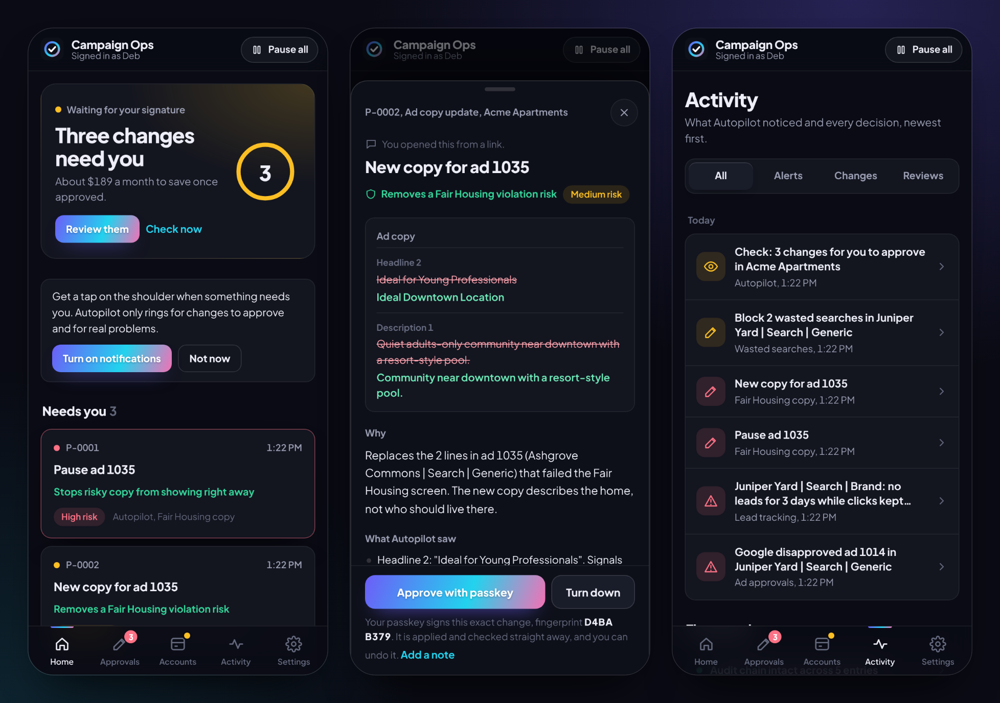
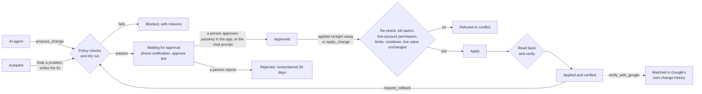
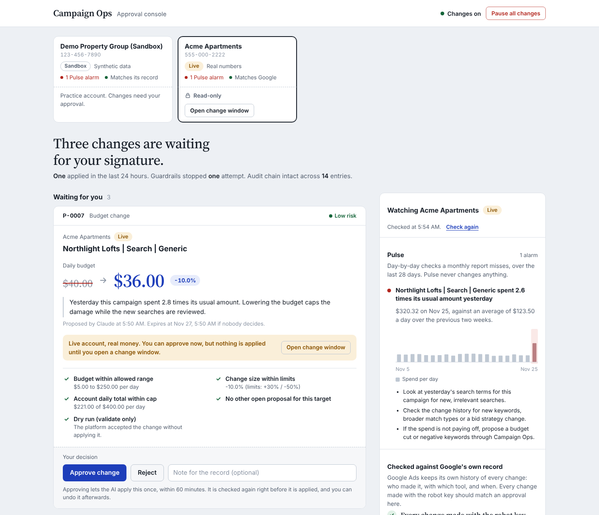

# Campaign Ops MCP

**Autopilot for Google Ads, with a person in the loop.** It watches your accounts every hour, writes the fix as a proposal, rings your phone, and applies only what you sign with your passkey. Every change is checked, dry-run, approved by a person, applied, verified and reversible, with Fair Housing guardrails, a tamper-evident audit log, and an independent check against Google's own change history. Claude (or any MCP client) can use the same engine, under the same rules.

**[See the live run on Google Ads](https://debashishkumarbora.github.io/agents/campaign-ops/)**: the record of its first run on a real Google Ads test account. It found an ad that broke Fair Housing rules, waited for a person to approve the fix, then changed the ad through the Google Ads API and verified it.

**[Try the live demo](https://debashishkumarbora.github.io/campaign-ops/)**: the real engine, compiled to run in your browser on a fictional sandbox account. Approve the agent's fixes, then try to make it misbehave.

It runs on three kinds of account, side by side:

| Account | Numbers | Changes |
|---|---|---|
| Built-in sandbox | Synthetic, with problems planted on purpose | With your approval |
| Google Ads test account | Simulated (test accounts never show ads) | With your approval, through the Google Ads API |
| Live Google Ads account | Real spend, clicks, leads and search terms | Each change signed with your passkey (in the cloud), or inside a change window a person opens (on a computer) |



## What's new in 0.5: Autopilot

- **It watches without Claude.** Every hour, on Cloudflare's free plan: Google's change history, ad disapprovals and your landing pages. Every morning, a full review: Pulse, wasted searches, Fair Housing copy, budgets, monthly pacing and the results of last week's changes.
- **It writes the fix.** Findings become ordinary proposals signed "Autopilot", each with what it is worth and the facts behind it. They pass the same guardrails and dry run as anything Claude proposes.
- **Approve means apply.** Your phone buzzes, you look at the change, Face ID signs it, and it is applied and verified straight away. On a live account the signature is the permission for that one change.
- **The free AI, on a short leash.** Cloudflare Workers AI double-checks searches before they are blocked (it can only take a search off the list, never add one) and writes replacement ad copy. Copy is accepted only if it passes the Fair Housing screen, fits Google's limits and adds no number, offer or amenity the ad did not already state.
- **It remembers and follows up.** A change you turn down is not proposed again for 30 days. A week after a change on a live account it checks the result, and proposes the undo if leads fell beyond chance. When a broken page comes back, it proposes turning the campaign back on.
- **Calm by default.** Quiet hours hold everything but urgent alerts until morning, then send one summary. Broken tracking puts changes to that campaign on hold, because its numbers cannot be trusted.
- **A new app for phone and desktop.** Five places: Home, Approvals, Accounts, Activity and Settings. The start screen answers one question, does anything need me, and details open on tap.
- **Tested end to end on Cloudflare's runtime:** `npm run test:cloud` (27 steps) now includes Check now, the AI-written copy, Google's disapproval, a landing page that goes down on the hourly tick, and Autopilot's settings.

To update a cloud copy: download the new version, then run `npm run cloud:deploy`. Nothing else changes: passkeys, notifications and history stay.

## What's new in 0.4: in the cloud, signed with your passkey

- **Runs on Cloudflare's free plan.** `npm run cloud:setup` puts the MCP server and the approval console on your own Cloudflare account. Claude connects to it as a custom connector, from the web, desktop and phone apps.
- **Passkeys, not passwords.** You sign in with a passkey (Face ID, Touch ID or Windows Hello). Every approval, undo, change window and resume is signed by that passkey over a hash of the exact change, and the console can check every stored signature again at any time.
- **The AI still cannot approve.** Claude connects through OAuth 2.1 with PKCE, and allowing it takes your passkey. In the cloud there is no approval prompt inside the chat: changes are approved only in the console, signed.
- **On your phone.** The console installs to the Home Screen and sends a notification when a change needs you.
- **Your history comes along.** Setup moves the proposals and the audit log from your computer to the cloud once, after checking the hash chain.
- **Tested end to end on the real runtime:** `npm run test:cloud` runs the Worker in Cloudflare's own runtime with a virtual passkey, a fake Google Ads API and a push service that decrypts every notification.

## What's new in 0.3

- **Live accounts, read-only by default.** `npm run gads:add` connects a real Google Ads account. Campaign Ops reads its real numbers, but nothing can change until a person opens a time-boxed change window in the console by typing the account's name. No tool can open one.
- **Google as witness.** `verify_with_google` compares Google's own change history with the approval log. Every change made with the Campaign Ops key must match an approved proposal. Anything else raises an alarm, and edits by people, other tools and Google's auto-applied recommendations are listed.
- **Pulse.** Day-by-day alarms a monthly report misses: conversion tracking that stopped while clicks kept coming, campaigns that stopped spending, overnight spend spikes and lead drops. Each alarm says how unlikely the pattern is by chance.
- **Approve links.** Every proposal comes with a link that opens the console on that exact proposal.
- **Pause one ad.** `set_ad_status` pauses or enables a single ad. A Fair Housing problem gets a one-step stopgap: pause the ad now, fix the copy next. A flagged ad cannot be turned back on until its copy is fixed.
- **A redesigned console** that works on a phone, ready for approving away from the desk.

## Why this exists

Google's official Google Ads MCP server is read-only. Its tools search an account, describe resources and list accounts. Reading is the easy part.

Once an agent can change budgets, negative keywords or ad copy, it needs the same controls a careful media buyer uses: limits, a second pair of eyes, a record of every decision, and an undo. Campaign Ops is that control layer, built as an MCP server that any MCP client can use.

## How a change flows



## Guardrails

| Guardrail | What it does |
|---|---|
| No self-approval | There is no approve tool. Only a person can approve: on a computer through an approval prompt in the chat app (MCP elicitation) or the local console; in the cloud only in the app, with a passkey signature over the exact change. Autopilot proposes through the same path and cannot approve either. |
| Live accounts stay read-only | A live account can be read and proposals can be approved, but a change is applied only with a person's permission: a passkey signature over that exact change (in the cloud), or a change window opened in the console. Windows last 1 to 8 hours, end on their own, and can be locked early. The backend itself refuses live writes without one of the two. |
| Scopes | `read`, `propose` or `execute`. Tools outside the scope are not even listed to the AI. |
| Budget limits | Step limits per change (+30% / -50% by default), a per-campaign range, and an account-wide daily cap. |
| Fair Housing screening | Ad copy that states a preference or limitation (for example "adults only" or "perfect for couples") is blocked. Coded or age-signaling language is flagged for review. Re-enabling a flagged ad is blocked too. |
| Protected searches stay visible | Negative keywords that would exclude protected groups are always blocked. A naive optimizer would cut "wheelchair accessible apartments" for having zero conversions. Campaign Ops refuses, and says why. |
| Collateral-damage check | Negatives that would also block converting searches are flagged, or blocked above a threshold. |
| Brand protection | Negatives that would block searches for your own community name are blocked. |
| Dry run | Every proposal is validated by the platform without being applied (the Google Ads API calls this `validate_only`). |
| Drift detection | If someone changed the live value after the proposal, nothing is overwritten. The result is a conflict, and the agent re-proposes from fresh data. |
| Approval binding | An approval is tied to a hash of the exact change. Editing the stored proposal afterwards is detected and refused. |
| Expiry | Proposals expire after 24 hours and approvals after 60 minutes. |
| Rate limits and cooldowns | Caps changes per hour and per day, and spaces out repeat changes to the same target. One open proposal per target. |
| Kill switch | One click in the console pauses every change, inside a change window too. An environment variable can force it on, overriding everything. |
| Verification | After writing, the account is read back and compared with the expected state. |
| Rollback is a proposal | An undo goes through the same checks and approval. Undoing a Fair Housing fix is blocked, because it would restore the violation. |
| Tamper-evident audit log | Every event is written to a hash-chained log. Editing or deleting any line breaks the chain, and the tool reports exactly where. |
| Google as witness | Google Ads keeps its own record of every change for 30 days. Campaign Ops checks itself against it: a change made with its key that matches no approval is an alarm. |

## Oversight

**Pulse** reads each campaign's daily numbers and raises an alarm only when a pattern is very unlikely to be chance. It uses a Poisson model of leads per click, so every alarm says how unlikely it is in plain words, for example "about 1 in 95". Four alarms:

| Alarm | What it catches |
|---|---|
| Tracking outage | No leads for several days while clicks kept coming. Usually a broken form or tag, not the ads. Automated bidding reacts to the false drop, so it is listed first. |
| Stopped spending | An enabled campaign that suddenly spends nothing: disapprovals, billing or an end date. |
| Spend spike | Yesterday far above the usual daily spend. |
| Lead drop | Leads per click fell by more than half this week while clicks held. |

**The witness check** compares Google's change history with the approval log. It reports every robot change that matched an approved proposal, any change made with the robot's credentials that matches nothing (someone used the key outside Campaign Ops), applied proposals Google has no record of, and the edits people, other tools and Google's own auto-applied recommendations made. The sandbox keeps the same kind of history, so the check works in the demo too.

Neither one changes anything. They say what to check, and any fix still goes through a proposal and approval.

## Autopilot

Autopilot is the part that works while nobody is looking. It reads the account, decides what is wrong, writes each fix as a proposal and tells your phone. It never approves: a fix sits in Approvals until you sign it, then it is applied and verified at once.

**When it runs**

| | What happens |
|---|---|
| Every hour | Google's change history (edits made outside Campaign Ops, and any robot change nobody approved), ads Google disapproved or limited, and every landing page your ads send people to. It also applies anything you approved that had to wait, for example for a cooldown, and sends the summary held during quiet hours. |
| Every morning (7:00 in your time zone by default) | The full review: Pulse, the health check, Fair Housing screening, wasted searches, budgets, monthly pacing, fuller ads and the results of past changes. Then one notification for whatever needs you. |
| When you tap Check now | The full review, right away. Claude can ask for one too, with `request_autopilot_check`. |

**What it does, skill by skill.** Each one can be turned off in Settings.

| Skill | What it does | It can propose |
|---|---|---|
| Lead tracking | Spots when leads stop being recorded while clicks keep coming, and holds changes on that campaign | Nothing: it tells you what to check |
| Stalled campaigns | A running campaign that suddenly spends nothing | Nothing |
| Spend spikes | A day far above the usual spend | Nothing |
| Lead drops | Leads per click well below normal, with the odds it is luck | Nothing |
| Outside changes | Edits made in Google Ads by people or other tools, and robot changes nobody approved | Nothing: an urgent alarm |
| Ad approvals | Ads Google disapproved or limited, with Google's reason | Nothing |
| Landing pages | A page that fails two checks in a row (an error or no answer, not a page that refuses robots) | Pausing the campaign or ads that send people there, and turning them back on when the page works |
| Fair Housing copy | Ad copy that states a preference about who should live there | Pausing the ad at once, replacement copy, then turning the ad back on |
| Wasted searches | Searches that cost money and never brought a lead, double-checked by the AI | Negative keywords. Searches tied to a protected group are never blocked |
| Spend without leads | A campaign that spends for weeks without a lead | Pausing it |
| Budget for winners | A campaign with cheap leads that runs out of budget | A budget raise within your step limit |
| Monthly pacing | Spend heading over a monthly target you set | Trimming the least efficient budgets first |
| Fuller ads | Ads with few headlines or descriptions | New lines, written by the AI only from what the ad already says |
| Results check | Each change a week later, on accounts with real numbers | The undo, if leads fell beyond chance |

**What it will not do**

- Approve anything, or apply anything you did not sign.
- Propose more than six changes per review (you can choose 1 to 10). Urgent fixes, such as pausing risky copy or a campaign pointing at a broken page, always go through.
- Ask again for something you turned down (30 days), something a guardrail stopped (7 days) or something that expired unanswered (3 days).
- Change a campaign whose lead tracking is broken, except for Fair Housing fixes and broken pages.
- Let the AI's words through unchecked. A search the AI was not sure about stays unblocked. A line of copy is refused if it fails the Fair Housing screen, mentions a protected group, adds a number, price, offer or amenity the ad did not state, repeats a line, or breaks Google's limits.
- Watch the sandbox once a real account is connected: its numbers are the same simulation, so it would only repeat itself. You can turn any account on or off in its page.

**Where it runs.** In the cloud, a Cron Trigger fires every hour and the Durable Object works through Autopilot's jobs one at a time on its alarm, so every step is a short request inside the free plan. The free AI (Workers AI: Gemma 4 26B, with Llama 3.3 70B as a fallback) makes at most 40 calls a day, a small part of the free plan's 10,000 daily Neurons. On a computer, Autopilot runs every hour while the console is open, uses rules only (no AI), and `CAMPAIGN_OPS_AUTOPILOT=off` turns the timer off.

## Quick start

Requires [Node.js](https://nodejs.org) 22 or newer (any current LTS) and Git.

```bash
git clone https://github.com/debashishkumarbora/campaign-ops-mcp.git
cd campaign-ops-mcp
npm install
npm test        # 115 tests: guardrails, Autopilot, live accounts, Pulse, witness, passkeys, push, console security, MCP over stdio, Google Ads API
npm run demo    # a narrated run through every guardrail
npm run test:cloud   # optional: the cloud version end to end, 27 steps (needs Playwright with Chromium)
```

Everything runs against a sandbox account with synthetic data. No Google account is needed yet.

## Call the tools yourself

```bash
npm run build
npm run inspect
```

This opens [MCP Inspector](https://github.com/modelcontextprotocol/inspector) in your browser. Click **Connect**, open **Tools**, and run `run_diagnostics` with `account_id` set to `123-456-7890`.

## The approval console

```bash
npm run console
```

This opens the console in your browser with your key, and the browser remembers it. Proposals appear within a few seconds of the agent making them, and the approve link from the chat opens the exact one. The same app runs in the cloud, signed in with a passkey.



- **Home** answers one question: does anything need me? It shows what is waiting, about how much it saves, and what Autopilot noticed lately. **Check now** runs a review.
- **Approvals** opens each change on tap: what changes (old value struck through, new value beside it), why, the facts Autopilot saw, every check, and one button that approves and applies it. Decided and stopped proposals are one tap away, with undo.
- **Accounts** shows each account's kind and health. Its page has Pulse alarms with a chart of the days behind them, the ledger against Google's record, the change window for live accounts, and Autopilot's switch and monthly target for that account.
- **Activity** lists everything Autopilot noticed and every decision by day, with the hash-chained audit log and, in the cloud, a check of every passkey signature.
- **Settings** has Autopilot (on or off, review time, time zone, quiet hours, skills, changes per review), notifications, passkeys, Pause all changes, and light or dark.
- On a phone it is an app with a tab bar; on a computer the same five places sit in a sidebar and a change opens beside the list.

The console listens on `127.0.0.1` only, requires a key the AI never sees, checks the Host header (DNS rebinding), refuses cross-site requests, escapes everything the AI writes, and runs under a strict Content Security Policy. Pulse and witness results are reused for five minutes, so the console never burns through the API's daily limits.

## The browser demo

The live demo runs the same engine, sandbox, diagnostics and Fair Housing code as the MCP server. `scripts/build-web.mjs` bundles them with esbuild and swaps only Node's file system, path and hashing modules for small in-memory versions (`web/shims`), so every guardrail behaves exactly as it does in Node. SHA-256 output matches Node byte for byte.

```bash
npm run build:web   # writes web/site/engine.js
```

`web/site` is a static site (HTML, CSS, JS). Host it anywhere, for example GitHub Pages. Add `?embed=app` to the address for a compact app view with only the workspace and a Replay tab, which is how the portfolio's phone app shows it.

## Connect an AI client

Campaign Ops runs as a local (stdio) MCP server. Point your MCP client at the built entry file:

```json
{
  "mcpServers": {
    "campaign-ops": {
      "command": "node",
      "args": ["/full/path/to/campaign-ops-mcp/dist/src/index.js"]
    }
  }
}
```

On Windows, use a path like `C:\\Users\\you\\campaign-ops-mcp\\dist\\src\\index.js`. Running it in the cloud instead? Add it as a connector (below) and remove this entry. Then ask: *"Run a health check on my ad account and propose fixes."* The server also ships two prompts, `account_health_check` and `fix_wasted_spend`.

## Run it in the cloud

You need a free [Cloudflare](https://dash.cloudflare.com/sign-up) account. In the project folder:

```bash
npm run cloud:setup
```

It signs you in to Cloudflare (a browser window opens the first time), uploads Campaign Ops, saves its secrets in Cloudflare, moves your history there once, and prints your address and a one-hour setup code. Then:

1. On your phone, open the address, type the setup code, and create your passkey.
2. On iPhone, tap Share, then Add to Home Screen. Open Campaign Ops from the Home Screen, sign in with Face ID, and turn on notifications.
3. In Claude, open Customize, then Connectors, then Add custom connector. Use your address followed by `/mcp`. Press Connect and allow it with your passkey.
4. On your computer, run `npm run cloud:unlink-desktop` so Claude Desktop stops starting the local copy.

| Command | What it does |
|---|---|
| `npm run cloud:setup` | First setup, or a fresh setup code plus new Google Ads settings. Existing session and notification keys are kept |
| `npm run cloud:deploy` | Updates the code after you download a new version. Secrets, passkeys and history stay as they are |
| `npm run cloud:code` | A new one-hour setup code, to add a passkey on a device when no signed-in device is at hand |
| `npm run cloud:unlink-desktop` | Removes the local Campaign Ops entry from Claude Desktop, after saving a copy of its settings |

To add a computer, sign in on it with your phone (choose the option to use a phone and scan the code), then add its own passkey in Settings. Or use `npm run cloud:code`. Passkeys belong to the address they were made on: if you later move Campaign Ops to your own domain, make passkeys there with a setup code.

**What runs where**

| Part | On Cloudflare |
|---|---|
| MCP server for Claude | A Worker at `/mcp`, behind OAuth 2.1 ([workers-oauth-provider](https://github.com/cloudflare/workers-oauth-provider)) |
| Approval console | Static files served by the same Worker, with a strict Content Security Policy |
| Proposals, audit log, passkeys, sandbox, Autopilot's memory | One Durable Object with its own SQLite database. The unchanged engine runs inside it: `node:fs` is swapped for a small file layer on SQLite |
| Connector grants and tokens | Workers KV, tokens stored only as hashes |
| Autopilot | A Cron Trigger every hour (at minute 17) queues its jobs; the Durable Object runs them one by one on its alarm |
| The free AI | Workers AI, through a binding: nothing to sign up for and no API key |
| Robot key, session and notification keys | Encrypted Worker secrets. None is written into the project folder |

**Free plan.** Cloudflare's free plan gives each request 10 ms of CPU, with some flexibility for the occasional longer one. Campaign Ops requests take a few milliseconds once warm, Autopilot splits its work into small steps, and the app asks for fresh data only while it is on screen. Workers AI includes 10,000 Neurons a day; Autopilot stops at 40 AI calls a day and falls back to its rules. If you ever see "Worker exceeded resource limits", the Workers Paid plan lifts it.

## Connect a Google Ads test account

Campaign Ops can work on a real Google Ads **test account**: real campaigns, real API calls and Google's own dry run, in an account that can never show ads or spend money.

1. In [Google Cloud](https://console.cloud.google.com), create a project and enable the **Google Ads API**. New projects start with **Test** access, which only works with test accounts.
2. In the same project, create a service account and download its JSON key. Save it as `~/campaign-ops-secrets/google-ads-key.json`, outside this folder so it can never be committed.
3. Create a [Google Ads test manager account](https://developers.google.com/google-ads/api/docs/first-call/test-accounts). Under **Admin > Access and security > Users**, add the service account email with **Admin** access (setup creates the test ad account inside it).
4. Run:

```bash
npm run gads:check -- 724-800-0350   # your test manager account number
npm run gads:setup                   # creates "Demo Apartments" and builds the sample campaigns
```

5. Restart your MCP client. `list_accounts` now shows the sandbox and the test account side by side, and the approval console labels which account each change is for.

No developer token is needed: since September 2026, Google Ads API access belongs to the Cloud project.

Before any change, Campaign Ops asks Google whether the account is a test account and refuses if it is not. `npm run gads:setup -- --fresh` rebuilds the sample campaigns. The setup run is noted in the audit log, so the witness check counts its changes as expected.

## Connect a live Google Ads account

A live account needs two things from Google first:

1. **Explorer access (or higher)** for the Cloud project that owns the robot. Test access cannot touch real accounts. Google reviews each request for a higher access level.
2. **The robot added as a user** of the account, or of a manager account above it: **Admin > Access and security > Users**, add the service account email. Start with **Read only**. Campaign Ops can still read everything, and Google itself blocks every change. Switch it to **Standard** only when you want approved changes to go through.

Then:

```bash
npm run gads:add -- 123-456-7890              # connect it (read-only in Campaign Ops)
npm run gads:add -- --list                    # show what is connected
npm run gads:add -- --remove 123-456-7890     # disconnect it
```

`gads:add` finds how the robot can reach the account (directly or through a manager), confirms with Google that it is a live ad account, reads its campaigns and last 30 days of spend so you can see the numbers are real, and saves it. It changes nothing in Google Ads. If Explorer access is still under review, it says so and stops.

| | Live Google Ads account |
|---|---|
| Spend, clicks, leads, search terms | Real, from Google |
| Pulse and the witness check | On real numbers and Google's real change history |
| Changes | Each one needs a person's permission: in the cloud, the passkey signature on that change; on a computer, a change window opened in the console by typing the account name. Every change still needs its own approval |
| Dry run | Google's own `validateOnly`, always allowed because it changes nothing |

## Tools

| Tool | What it does | Scope |
|---|---|---|
| `list_accounts` | Accounts this server can reach, their mode, and whether changes are allowed right now | read |
| `get_account_overview` | Spend, leads, cost per lead, budget use, impression share lost to budget | read |
| `get_search_terms` | What people searched before clicking, with cost and conversions | read |
| `get_ads` | Ad copy with a Fair Housing screening result per ad | read |
| `run_diagnostics` | Ranked findings with ready-to-propose changes, Pulse alarms, stopgap pauses for Fair Housing problems, and searches that must not be excluded | read |
| `check_pulse` | Day-by-day alarms with how unlikely each pattern is, and what to check | read |
| `verify_with_google` | Google's own change history compared with the approval log | read |
| `check_ad_copy` | Screens draft copy before proposing: Fair Housing, character limits, punctuation | read |
| `get_policy` | The guardrails in force, change windows and the kill switch state | read |
| `list_proposals` / `get_proposal` | Proposal status, every check, the approve link, and the next step | read |
| `get_audit_log` | Recent audit entries and chain integrity | read |
| `get_autopilot_report` | What Autopilot found lately, what is waiting for approval, and its settings | read |
| `request_autopilot_check` | Asks Autopilot for a full review now. Anything it wants to change still becomes a proposal | propose |
| `propose_change` | The only way to request a change: budgets, campaign status, negative keywords, ad copy, or one ad's status. Runs every check and the dry run, and returns an approve link | propose |
| `request_rollback` | Creates an undo proposal for an applied change | propose |
| `apply_change` | Applies an approved change, re-checking everything first, then verifies | execute |

There is no tool to approve a change or open a change window. Both are human-only.

## Configuration

Copy `.env.example` to `.env` to change settings, and edit `policy.json` to change limits, including `live.maxWindowHours` (8 by default). Fair Housing checks are always on and cannot be switched off in configuration.

| Variable | Default | Meaning |
|---|---|---|
| `CAMPAIGN_OPS_SCOPE` | `execute` | `read`, `propose` or `execute` |
| `CAMPAIGN_OPS_CONSOLE_PORT` | `4848` | Console port on 127.0.0.1. `0` turns it off |
| `CAMPAIGN_OPS_CONSOLE_TOKEN` | generated | Fixed console key (16+ characters) |
| `CAMPAIGN_OPS_KILL_SWITCH` | `0` | `1` refuses every change |
| `CAMPAIGN_OPS_DATA_DIR` | `./data` | Where state lives |
| `CAMPAIGN_OPS_POLICY_FILE` | `./policy.json` | Alternative policy file |
| `CAMPAIGN_OPS_GOOGLE_ADS` | on when set up | `off` hides the Google Ads accounts |
| `CAMPAIGN_OPS_SECRETS_DIR` | `~/campaign-ops-secrets` | Where the robot key and Google Ads connection settings live |
| `GOOGLE_ADS_API_VERSION` | `v26` | Google Ads API version |
| `CAMPAIGN_OPS_AUTOPILOT` | on | `off` stops Autopilot's hourly check while the local console runs (Check now still works) |

`npm run reset` rebuilds the sandbox. When a Google Ads account is connected it keeps proposals and the audit log, because they are the record of real changes the witness check matches with Google. `npm run reset -- --all` clears them too.

## Threat model

**Defends against**

- An agent approving its own changes: no approve tool exists, and both approval channels are human-only.
- An agent unlocking a live account: change windows exist only in the console, need the console key, and need the account name typed by a person.
- Someone using the robot key outside Campaign Ops: the witness check finds every change made with it in Google's own history that matches no approval.
- Prompt-injected text in a proposal attacking the reviewer: all AI-written text is escaped, a strict CSP blocks scripts, and `frame-ancestors 'none'` blocks clickjacking.
- Other web pages in your browser calling the console: key required, Host header checked, JSON-only same-origin POSTs. Approve links carry only a proposal number, never the key.
- Stale or silently edited approvals: binding hash, expiry and drift checks.
- Runaway loops: rate limits, cooldowns, one open proposal per target, and the kill switch.
- Quiet history edits: the hash-chained audit log.

**In the cloud, also**

- A connected AI approving or unlocking anything: approve, undo, change windows and resume each need a passkey signature made in the console. Allowing a connector needs one too, and the chat approval prompt is turned off.
- A signature reused for something else: each passkey challenge commits to the action, its target and, for an approval, the hash of the exact change. Challenges work once and expire after five minutes. If the change no longer matches, the approval is refused.
- A stolen session cookie: it can look, reject and pause, nothing more. The cookie is `__Host-`, HttpOnly, Secure and SameSite=Strict, and removing a passkey ends its sessions.
- Someone who finds the address: there is no password to guess. Setup codes work once, for one hour, with five tries per 15 minutes.
- Notifications as a side door: they go only to the browsers' own push services, encrypted end to end (RFC 8291) and signed (RFC 8292).
- Strangers using up the free quota: opening the connect page and registering an app have a daily budget, and stored sign-in challenges are capped.

**With Autopilot, also**

- Autopilot approving its own work: it calls the same `propose` path as any agent. Approving, and the permission for a live account, still need a person.
- The AI going wrong: it can only remove searches from a list Autopilot built by rule, and every line of copy it writes is checked by code (Fair Housing, protected groups, no new numbers, prices, offers or amenities, Google's limits) before a person sees it.
- Alarm fatigue: alerts are sent once, not every hour; quiet hours hold all but urgent news; and anything you turn down stays down for 30 days.
- A runaway day: at most a set number of proposals per review, at most 12 open at once, and the same rate limits, cooldowns and kill switch as everything else.

**Out of scope**

- A compromised computer, a compromised Cloudflare account, or an MCP client that fakes the approval prompt.
- An agent that also has file access to the data folder. Do not give the same agent a filesystem tool for this folder.
- Legal review. The Fair Housing checks are a screening aid, not legal advice.

## A note on Fair Housing

Section 804(c) of the Fair Housing Act prohibits housing ads that state a preference, limitation or discrimination based on race, color, religion, sex, disability, familial status or national origin. Many states and cities protect more, such as source of income. The screening rules flag common risk patterns so a person looks before anything ships. They cannot prove that copy is compliant.

## Roadmap

- [x] **Milestone 1:** governance engine, sandbox account, approval console, 28 tests
- [x] **Connected to Claude Desktop:** a real session found the problems, waited for approval, applied and verified three fixes
- [x] **Public browser demo** of the real engine, with a replay of the Claude session
- [ ] **Milestone 2:** approval card inside the chat with [MCP Apps](https://blog.modelcontextprotocol.io/posts/2026-01-26-mcp-apps/)
- [x] **Milestone 3:** Google Ads test-account backend (real API calls, no ads served, no spend). Live run done: Claude found a Fair Housing problem in a real Google Ads test account, a person approved the fix, and the agent rewrote the ad through the Google Ads API
- [x] **Real-account mode (0.3):** live accounts read-only until a person opens a change window, Pulse alarms, the witness check against Google's change history, approve links, single-ad pause, and a phone-ready console
- [x] **Milestone 4 (0.4):** a remote MCP server and the approval console on Cloudflare Workers, with passkey-signed approvals, OAuth for Claude, phone notifications and a morning watch
- [x] **Milestone 5 (0.5):** Autopilot: hourly watch and a daily review with 14 skills, fixes written as proposals with the free AI, approve-means-apply, results checks with undo proposals, and a redesigned app
- [ ] **Milestone 6:** evaluation suite that scores agent runs for safe behavior

## Project structure

```
src/
  index.ts              MCP server entry (stdio)
  server.ts             Tools, prompts, approval prompt, approve links, wait-for-approval
  governance/
    engine.ts           Proposal lifecycle: propose, approve, apply, verify, rollback, change windows
    changes.ts          Per-change logic: state, checks, risk, diff, inverse
    fairHousing.ts      Ad copy screening and protected-term detection
    diagnostics.ts      Findings, suggested changes and stopgaps
    pulse.ts            Day-by-day alarms with Poisson odds
    witness.ts          The approval log checked against the platform's own change history
    audit.ts            Hash-chained audit log
  backends/
    backend.ts          The ad platform interface
    sandbox.ts, seed.ts Synthetic account with planted problems and its own change history
    router.ts           Sandbox and Google Ads accounts side by side
    googleAds/          Google Ads API: robot login, REST client, backend, sample campaigns
  autopilot/
    autopilot.ts        The jobs: hourly watch, the daily review in small steps, approve-means-apply, notifications
    skills.ts           What each fix skill proposes, and what Autopilot remembers
    ai.ts               The free AI's three jobs, and the code that checks everything it writes
    landing.ts          Landing page checks
    outcomes.ts         The results check a week after a change
    settings.ts, store.ts  Settings, quiet hours, and Autopilot's memory
  console/api.ts        The console's API, shared by the local server and the cloud
  console/server.ts     Approval console HTTP server (local)
  cloud/                Passkeys (WebAuthn), signed sessions, web push, and the file layer on SQLite
  util/time.ts          Account time zones (Google reports dates and change times in them)
cloud/
  src/worker.ts         The Worker: OAuth for the MCP endpoint, the passkey consent page, security headers, cron
  src/ops.ts            The Durable Object: engine, console API, passkeys, notifications, history import, Autopilot's job queue
  wrangler.base.jsonc   Cloudflare settings (npm run cloud:setup makes wrangler.jsonc from it)
console-ui/             The app (plain HTML, CSS, JS), its typeface, app manifest, icons and service worker
web/                    Browser build: entry, Node shims, and the static demo site
scripts/                demo, console, reset, gads:*, cloud:*, test runner
test/                   node:test suites, with a fake Google Ads API
test/e2e/               The cloud end-to-end check (wrangler dev, Playwright, a virtual passkey, an AI stand-in)
```

## License

MIT. Built by [Debashish Kumar Bora](https://debashishkumarbora.github.io).

The app's typeface is Plus Jakarta Sans by Tokotype, used under the SIL Open Font License 1.1 (`console-ui/fonts/LICENSE-plus-jakarta-sans.txt`).
