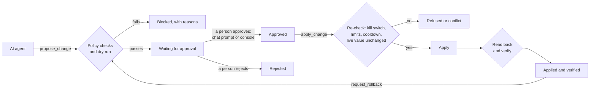

# Campaign Ops MCP

**Lets AI agents change Google Ads campaigns safely.** Every change is proposed, checked, dry-run, approved by a person, applied, verified and reversible, with Fair Housing guardrails and a tamper-evident audit log.


## Why this exists

Google's official Google Ads MCP server is read-only. Its tools search an account, describe resources and list accounts. Reading is the easy part.

Once an agent can change budgets, negative keywords or ad copy, it needs the same controls a careful media buyer uses: limits, a second pair of eyes, a record of every decision, and an undo. Campaign Ops is that control layer, built as an MCP server that any MCP client can use.

## How a change flows



## Guardrails

| Guardrail | What it does |
|---|---|
| No self-approval | There is no approve tool. Only a person can approve, through an approval prompt in the chat app (MCP elicitation) or the local approval console. |
| Scopes | `read`, `propose` or `execute`. Tools outside the scope are not even listed to the AI. |
| Budget limits | Step limits per change (+30% / -50% by default), a per-campaign range, and an account-wide daily cap. |
| Fair Housing screening | Ad copy that states a preference or limitation (for example "adults only" or "perfect for couples") is blocked. Coded or age-signaling language is flagged for review. |
| Protected searches stay visible | Negative keywords that would exclude protected groups are always blocked. A naive optimizer would cut "wheelchair accessible apartments" for having zero conversions. Campaign Ops refuses, and says why. |
| Collateral-damage check | Negatives that would also block converting searches are flagged, or blocked above a threshold. |
| Brand protection | Negatives that would block searches for your own community name are blocked. |
| Dry run | Every proposal is validated by the platform without being applied (the Google Ads API calls this `validate_only`). |
| Drift detection | If someone changed the live value after the proposal, nothing is overwritten. The result is a conflict, and the agent re-proposes from fresh data. |
| Approval binding | An approval is tied to a hash of the exact change. Editing the stored proposal afterwards is detected and refused. |
| Expiry | Proposals expire after 24 hours and approvals after 60 minutes. |
| Rate limits and cooldowns | Caps changes per hour and per day, and spaces out repeat changes to the same target. One open proposal per target. |
| Kill switch | One click in the console pauses every change. An environment variable can force it on, overriding everything. |
| Verification | After writing, the account is read back and compared with the expected state. |
| Rollback is a proposal | An undo goes through the same checks and approval. Undoing a Fair Housing fix is blocked, because it would restore the violation. |
| Tamper-evident audit log | Every event is written to a hash-chained log. Editing or deleting any line breaks the chain, and the tool reports exactly where. |

## Quick start

Requires [Node.js](https://nodejs.org) 22 or newer (any current LTS) and Git.

```bash
git clone https://github.com/debashishkumarbora/campaign-ops-mcp.git
cd campaign-ops-mcp
npm install
npm test        # 28 tests: guardrails, lifecycle, console security, MCP over stdio
npm run demo    # a narrated run through every guardrail
```

Everything runs against a sandbox account with synthetic data. No Google account is needed yet.

## Call the tools yourself

```bash
npm run build
npm run inspect
```

This opens [MCP Inspector](https://github.com/modelcontextprotocol/inspector) in your browser. Click **Connect**, open **Tools**, and run `run_diagnostics` with `account_id` set to `123-456-7890`.

## The approval console

```bash
npm run console
```

This opens the console in your browser with your key. Proposals appear within a few seconds of the agent making them. You can approve, reject with a note, undo applied changes in one click, pause all changes, and watch the audit chain.

The console listens on `127.0.0.1` only, requires a key the AI never sees, checks the Host header (DNS rebinding), refuses cross-site requests, escapes everything the AI writes, and runs under a strict Content Security Policy.

## Connect an AI client

Campaign Ops runs as a local (stdio) MCP server. Point your MCP client at the built entry file:

```json
{
  "mcpServers": {
    "campaign-ops": {
      "command": "node",
      "args": ["/full/path/to/campaign-ops-mcp/dist/src/index.js"]
    }
  }
}
```

On Windows, use a path like `E:\\campaign-ops-mcp\\dist\\src\\index.js`. Then ask: *"Run a health check on my ad account and propose fixes."* The server also ships two prompts, `account_health_check` and `fix_wasted_spend`.

## Tools

| Tool | What it does | Scope |
|---|---|---|
| `list_accounts` | Accounts this server can reach, and their mode | read |
| `get_account_overview` | Spend, leads, cost per lead, budget use, impression share lost to budget | read |
| `get_search_terms` | What people searched before clicking, with cost and conversions | read |
| `get_ads` | Ad copy with a Fair Housing screening result per ad | read |
| `run_diagnostics` | Ranked findings with ready-to-propose changes, plus searches that must not be excluded | read |
| `check_ad_copy` | Screens draft copy before proposing: Fair Housing, character limits, punctuation | read |
| `get_policy` | The guardrails in force and the kill switch state | read |
| `list_proposals` / `get_proposal` | Proposal status, every check, and the next step | read |
| `get_audit_log` | Recent audit entries and chain integrity | read |
| `propose_change` | The only way to request a change. Runs every check and the dry run | propose |
| `request_rollback` | Creates an undo proposal for an applied change | propose |
| `apply_change` | Applies an approved change, re-checking everything first, then verifies | execute |

## Configuration

Copy `.env.example` to `.env` to change settings, and edit `policy.json` to change limits. Fair Housing checks are always on and cannot be switched off in configuration.

| Variable | Default | Meaning |
|---|---|---|
| `CAMPAIGN_OPS_SCOPE` | `execute` | `read`, `propose` or `execute` |
| `CAMPAIGN_OPS_CONSOLE_PORT` | `4848` | Console port on 127.0.0.1. `0` turns it off |
| `CAMPAIGN_OPS_CONSOLE_TOKEN` | generated | Fixed console key (16+ characters) |
| `CAMPAIGN_OPS_KILL_SWITCH` | `0` | `1` refuses every change |
| `CAMPAIGN_OPS_DATA_DIR` | `./data` | Where state lives |
| `CAMPAIGN_OPS_POLICY_FILE` | `./policy.json` | Alternative policy file |

`npm run reset` rebuilds the sandbox and clears proposals and the audit log.

## Threat model

**Defends against**

- An agent approving its own changes: no approve tool exists, and both approval channels are human-only.
- Prompt-injected text in a proposal attacking the reviewer: all AI-written text is escaped, a strict CSP blocks scripts, and `frame-ancestors 'none'` blocks clickjacking.
- Other web pages in your browser calling the console: key required, Host header checked, JSON-only same-origin POSTs.
- Stale or silently edited approvals: binding hash, expiry and drift checks.
- Runaway loops: rate limits, cooldowns, one open proposal per target, and the kill switch.
- Quiet history edits: the hash-chained audit log.

**Out of scope**

- A compromised computer, or an MCP client that fakes the approval prompt.
- An agent that also has file access to the data folder. Do not give the same agent a filesystem tool for this folder.
- Legal review. The Fair Housing checks are a screening aid, not legal advice.

## A note on Fair Housing

Section 804(c) of the Fair Housing Act prohibits housing ads that state a preference, limitation or discrimination based on race, color, religion, sex, disability, familial status or national origin. Many states and cities protect more, such as source of income. The screening rules flag common risk patterns so a person looks before anything ships. They cannot prove that copy is compliant.

## Roadmap

- [x] **Milestone 1:** governance engine, sandbox account, approval console, 28 tests
- [ ] **Milestone 2:** approval card inside the chat with [MCP Apps](https://blog.modelcontextprotocol.io/posts/2026-01-26-mcp-apps/)
- [ ] **Milestone 3:** Google Ads test-account backend (real API calls, no ads served, no spend)
- [ ] **Milestone 4:** public sandbox as a remote MCP server on Cloudflare Workers
- [ ] **Milestone 5:** daily autopilot that runs diagnostics and queues proposals for approval
- [ ] **Milestone 6:** evaluation suite that scores agent runs for safe behavior

## Project structure

```
src/
  index.ts              MCP server entry (stdio)
  server.ts             Tools, prompts, approval prompt, wait-for-approval
  governance/
    engine.ts           Proposal lifecycle: propose, approve, apply, verify, rollback
    changes.ts          Per-change logic: state, checks, risk, diff, inverse
    fairHousing.ts      Ad copy screening and protected-term detection
    diagnostics.ts      Findings and suggested changes
    audit.ts            Hash-chained audit log
  backends/
    backend.ts          The ad platform interface
    sandbox.ts, seed.ts Synthetic account with planted problems
  console/server.ts     Approval console HTTP server
console-ui/             Console page (plain HTML, CSS, JS)
scripts/                demo, console, reset, test runner
test/                   node:test suites
```

## License

MIT. Built by [Debashish Kumar Bora](https://debashishkumarbora.github.io).
